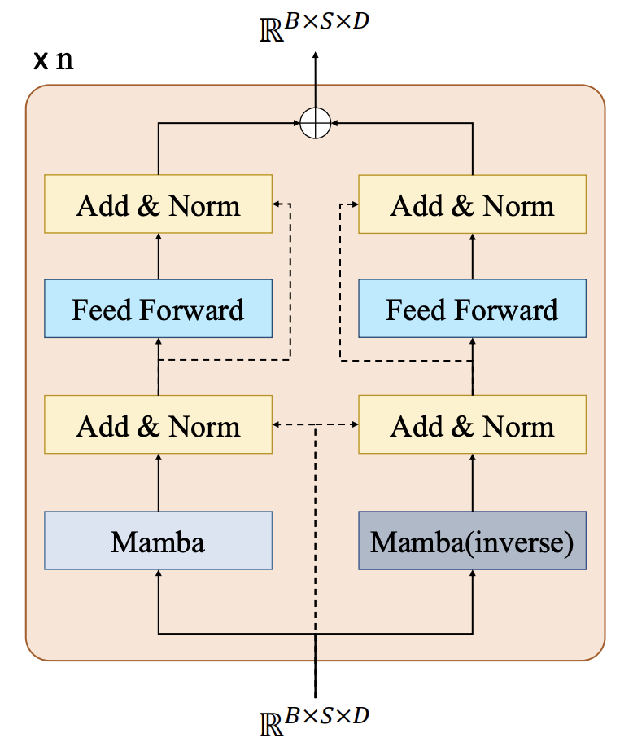

# BiMamba

## The original paper has opened up their official implementation, and it is more recommended to check their [GitHub repository](https://github.com/Leopold2333/Bi-Mamba4TS).

A simple Bidirectional Mamba based on pytroch, follow the paper [Bi-Mamba4TS: Bidirectional Mamba for Time Series Forecasting](https://arxiv.org/abs/2404.15772). The following model structure diagram is from this paper.

